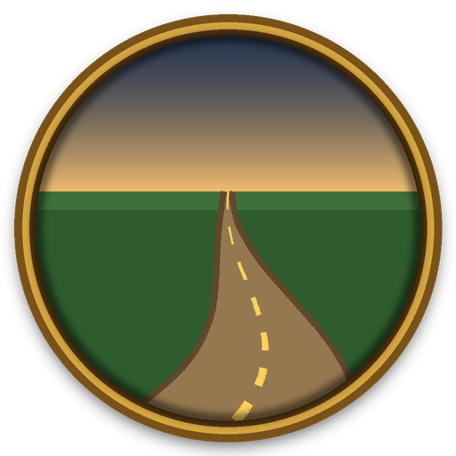

# RoadLog



Records the roads you walk, as paths in world coordinates, so they can be used later (for example to time trips by road in Waypoint). No dataset of Classic's roads exists, so this one is built by walking them.

The game can't tell an addon what the ground under you is. So the rule is simple: **while RoadLog is on, every step you take counts as road.** Turn it on when you step onto a road, walk down the middle of it, and turn it off when you leave it.

## The minimap button

- **Left-click** turns recording on or off. The icon is grayed out while it's off, and tinted red while you're logging blockers.
- **Right-click** opens a menu:
  - **Log roads**: what you walk is a road (walk down the middle of it).
  - **Log blockers**: what you walk is something you can't cross, such as a wall, fence or cliff edge (walk along it). Blockers show on the world map as red lines.
  - **Cave Logs**: what you walk is a path through a cave. See [Caves](#caves) below.
  - **Mark a narrow pass here**: drops a blue spot where you stand, for a gap, ramp or gate you can get through. Hover a spot for what it is; Shift+right-click it to remove it.
  - **Mark a zone transition here**: drops a purple spot where you stand, named after the zone you're in and the nearest other zone ("Durotar-The Barrens Transition"). Hover it for its name; Shift+right-click it to remove it.
  - Start or stop recording, undo the last thing logged, and Settings.
- **Drag** moves it around the minimap.

The tooltip shows what RoadLog is doing and how much road, blockers and passes you've logged. The button is also in the AddOn Compartment.

## Caves

Turn on **Cave Logs** (right-click menu, or `/roadlog cave`) and walk the cave's passages. The button turns teal.

- **What's logged.** A point goes down every 2 yards, and every point is kept: a straight passage can still go up or down. Each point also notes whether the game had you indoors, and every fall you take is marked where you land, with your time in the air. Recording doesn't pause indoors or while swimming in this mode.
- **Heights.** The game won't tell an addon your height (`UnitPosition` gives 0 for it on this client), so heights are worked out afterwards. `yarn build --dev` runs `tools\RoadLoguild_caves.py`, which:
  1. reads your logged caves from the saved variables;
  2. finds the cave's floors in the game files (the building models placed there, and the terrain);
  3. follows the floor you were on from point to point. Levels that pass over each other stay apart, a climb too steep to walk isn't allowed, and a drop only comes cheap where you fell. Indoor points never use the ground above the cave.

  The result is written to `Data\Caves.lua`.
- **After a build** (`yarn test`, then `/reload`):
  - the world map shades each cave from deep blue (its lowest point) to pale (its highest);
  - the minimap button's tooltip shows your height while you're on a logged path.

  Until then a cave is drawn flat teal, and the tooltip says how many stretches are waiting for heights.

## Settings

Options → AddOns → RoadLog: show or hide roads, blockers, caves, narrow passes and zone transitions on the world map, cleaned-up roads, and the minimap button.

## What it records

- While you move, a point goes down every 4 yards. On straight stretches the in-between points are dropped (anything within 0.75 yards of the straight line), so curves keep their detail and straight roads stay small.
- Standing still keeps the stretch open.
- **It pauses** while you're dead or a ghost, swimming, flying, on a flight path, indoors or in an instance. The stretch you were on ends there, and a new one starts when you move again. Recording stays on, so it picks up by itself once you're back on your feet.
- A hearthstone, portal or loading screen also ends the stretch, so no line joins the two places.
- Stretches shorter than 10 yards aren't kept.

Roads are saved for your whole account, so every character adds to the same map.

## Slash commands

| Command | What it does |
|---|---|
| `/roadlog` or `/roads` | Turn recording on or off (`on`, `off` also work) |
| `/roadlog map` | Show or hide the roads on the world map |
| `/roadlog road` / `/roadlog blocker` / `/roadlog cave` | Log roads, blockers, or caves |
| `/roadlog pass` | Mark a narrow pass where you stand |
| `/roadlog transition` | Mark a zone transition where you stand |
| `/roadlog options` | Open the settings |
| `/roadlog undo` | Delete the last road, blocker, pass or transition you logged |
| `/roadlog clear` | Delete every road, blocker, pass and transition (asks first) |
| `/roadlog stats` | Yards recorded per continent |
| `/roadlog minimap` | Show or hide the minimap button |

## The data

`RoadLogDB.roads` in `WTF\Account\<account>\SavedVariables\RoadLog.lua`:

```lua
roads = {
  [0] = {                -- the continent, as C_Map.GetWorldPosFromMapPos numbers it (0 Eastern Kingdoms, 1 Kalimdor)
    { zone = 1429,       -- the zone's map ID where the stretch started
      at = 1792345678,   -- when (time())
      pts = { n1, w1, n2, w2, ... } },  -- world yards: north, west, rounded to 0.1
  },
}
```

`RoadLogDB.caves` is the same, plus `name` (the cave's, from the minimap), `falls = { [point] = seconds in the air }` and `inside = "0011..."` (one character a point, 1 where you were indoors). Their heights are in `Data\Caves.lua`: `ns.CaveMap[continent][at] = { z = { height per point }, lo, hi }`, keyed by the stretch's `at`.

Each entry is one unbroken stretch, in the order you walked it. Roads you walk twice show up twice; merging them is left to whatever reads the data.

The art is drawn by `tools\RoadLog\make_icon.py`.
